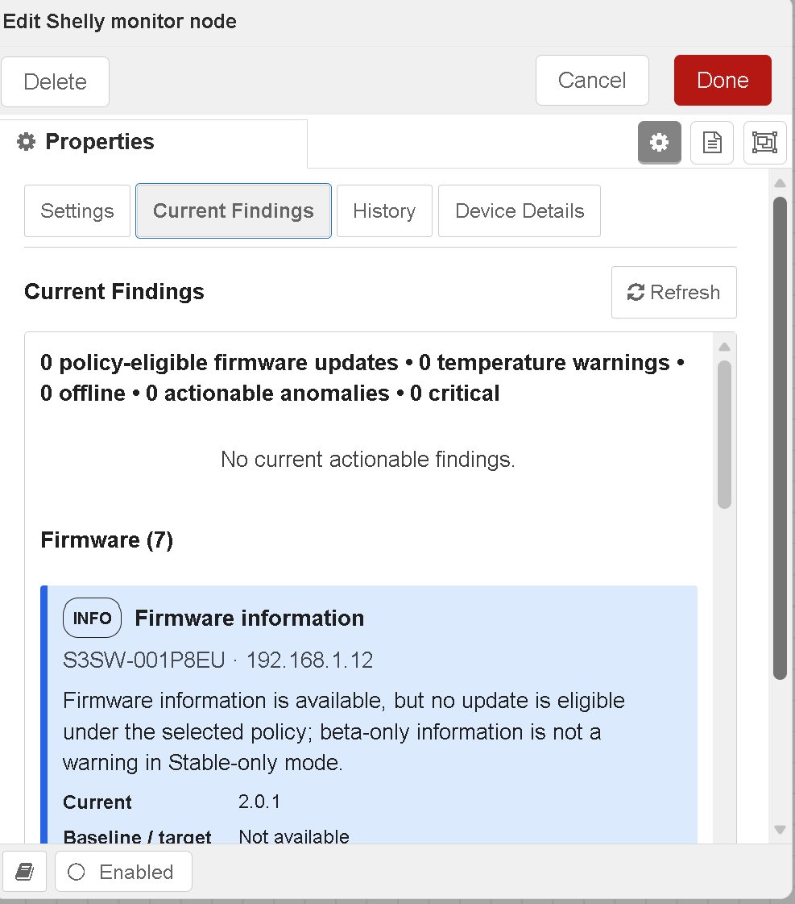

# @impact0815/node-red-contrib-shelly-admin

**English** · [Deutsch](README.de.md)

Node-RED nodes for local Shelly fleet administration: discovery, persistent inventory, firmware policy, guarded maintenance, historical monitoring, device baselines, cautious peer comparison, and explicit observation lifecycles. Shelly generations 1–4 are supported through the Gen1 and Gen2+ HTTP API families. MQTT is optional and is not a package dependency.

## Device names and lists in 0.5.1

Discovery and Monitor now retain the name configured on each Shelly (`Shelly.GetDeviceInfo.name` or `Sys.GetConfig.device.name` on Gen2+, `/settings.name` on Gen1) and follow device-side renames. Existing inventory entries migrate with `name: null` and are filled by the next successful request.

Monitor Device Details, Maintenance Device Overview and Config Device Settings use one slim custom device dropdown followed directly by the detail view; the separate all-device button list has been removed. Entries put the active sort key first and bold: `Name · Type · IP`, `Type · Name · IP`, or `IP · Name · Type`. Fallback names remain muted italics; long values use ellipsis plus full-text tooltips. Keyboard control (arrows, Enter, Escape), outside-click closing and no horizontal scrollbar remain supported. Persistent **Sort by: Type / Name / IP** affects only this dropdown; Name is the default and IPv4 sorting is numeric. A persistent multi-select model/type filter offers **All/None**, reports `Types: all` or `Types: n of m`, and opens a width-bounded, wrapping popover that remains inside the dialog; Maintenance status filters remain and combine with it. Manual refresh preserves sort, type filter, status filter, selection and scroll, with no editor auto-refresh. Detail views show a name heading and Name field. Observations/events carry `device.name`, and human summaries prefer it for downstream notifications.

Every inventoried device now resolves settings in the strict order **device override → device class → general configuration**. Existing devices migrate to **Standard** with no overrides. The built-in classes are Standard, Critical, Test device, and Poor connection; their presets can be refined, and each device override can independently return to inheritance.

The Config node's **Device Settings** tab loads inventory only when opened or when **Refresh** is clicked. It edits class defaults—including Standard—and per-device overrides and shows every effective value with its general/class/device origin. Reboot enablement, interval, immediate/maintenance-window mode, and maintenance-window time are independently inheritable at device → class → general level. For the selected class it also shows the effective maintenance window, every assigned device and that device's next planned reboot. Per-device details retain current/pre-reboot uptime and reboot classification. Missing telemetry is **Not available**, never synthetic zero.

All observations and emitted device events add `notify` and `deviceClass`. Existing schema identifiers and all three output positions are unchanged. Every Warning/Critical observation and finding also carries `uptimeSec`, `uptimeText`, and `uptimeTextDe`; its human summary includes current uptime or **Not available**. A notification flow can filter with `item.notify === true` and forward `summaryText`. See `examples/05-notify-routing.json`.

## Inventory evidence and direct device actions in 0.5.1

A Full scan keeps persistent inventory entries by design: a powered-off or physically removed Shelly may still be stored so identity, history and policy are not destroyed automatically. Current scan evidence is now separate: `foundDevices`, `foundThisScan`, `notFoundThisScan`, `inventoryNotScanned`, and each device's `lastScan.status` distinguish **found now**, **known but not found**, and **outside the current scan scope**. Public/editor reachability follows the latest direct probe immediately; `confirmedOffline` remains the debounced notification state.

Monitor **Device Details** adds **Reload all data** for a fresh device probe. If unreachable, the view provides Retry, bounded **Retry / Wait**, and confirmed **Remove**. Remove purges the persistent inventory entry and operational history/state. Class and override configuration is intentionally retained for safe rediscovery; remove it separately in Config Device Settings if permanent policy deletion is wanted.

A code- and test-based assessment, confirmed fixes, remaining risks and future architecture recommendations are in [docs/ARCHITECTURE-REVIEW-0.5.1.md](docs/ARCHITECTURE-REVIEW-0.5.1.md).

## Fleet dashboard


A ready-to-import, bilingual (EN/DE) dashboard for [FlowFuse Dashboard 2.0](https://dashboard.flowfuse.com/) built on the outputs of the discovery, monitor and maintenance nodes: fleet KPIs, cards and table view, search, filters and grouping, alerts, firmware overview, 24 h history per device and switching of relays and plugs with up to 4 channels. Firmware updates and reboots stay behind an explicit maintenance unlock.

→ [`examples/06-fleet-dashboard-flowfuse.json`](examples/06-fleet-dashboard-flowfuse.json) · [setup and details](examples/README.md#fleet-dashboard-flowfuse-dashboard-20)

## Safety and scope

> **⚠️ Use at your own risk – no warranty.** This is an unofficial community project and is not affiliated with, endorsed by, or supported by Shelly or Allterco. It is supplied “as is”.
>
> Trend and anomaly observations are **not guaranteed failure predictions**. They do not replace manufacturer protections, smoke alarms, professional electrical installation, inspection, fire protection, or supervised maintenance.
>
> Automatic temperature shutdown is disabled unless both the monitor is in **Explicit policy actions** mode and an exact device policy explicitly allows it. The package never automatically re-enables an output.

## Nodes and compatibility

| Node type | Purpose | Existing outputs retained |
|---|---|---|
| `shelly-admin-config` | Shared credentials, discovery, persistence, history, analysis and safety settings | Configuration node |
| `shelly-admin-discovery` | Full/incremental discovery and inventory validation | Inventory · events · errors |
| `shelly-admin-monitor` | Polling, history, observations and temperature safety | Health · alerts · errors |
| `shelly-admin-maintenance` | Firmware checks, dry-runs, rolling updates and conditional reboots | Result · per-device progress · errors |

Version 0.5.1 keeps the existing node type names, three-output wiring, Node.js 18+/Node-RED 3.1+ support, Gen1–Gen4 normalization, Context-store persistence, structured errors, temperature safety, and the dual `msg.action`/editor-control operation model.

## Unified action and lifecycle API

| Node | Start/run actions | Control actions |
|---|---|---|
| Discovery | `start`, `scan`, `full`, `incremental` | `cancel`, `status` |
| Monitor | `start`, `poll`, `check` | `cancel`, `status`, `enable`, `disable`, `refresh-device`, `wait-device`, `remove-device` |
| Maintenance | `start`, `check`, `update`, `reboot` | `cancel`, `status` |

Example:

```json
{"action":"scan","mode":"full","targets":"192.168.10.0/24"}
```

Every active run has a `runId`; progress and final payloads report `state`, `phase`, `processed`, `total`, `unprocessed`, timestamps, and a nested `shelly-admin.lifecycle/1` object. Common states are `started`, `running`, `cancel-requested`, `cancelled`, `completed`, `completed-with-issues`, and `failed`. `status` is read-only. `cancel` is idempotent and reports `idle` if no run is active.

Cancellation is propagated through bounded concurrency, HTTP requests, firmware checks, post-restart validation polling, and stagger waits. Completed device work is retained and persisted. Unstarted discovery targets are not marked unreachable, and a cancelled full scan does not advance its completion timestamp. A firmware update or reboot already accepted by a device cannot be rolled back; the result records the current device and the cancellation point.

The complete per-node message contract, lifecycle records, output topics, recovery examples, firmware workflows and cancellation semantics are in [docs/MESSAGE-API.md](docs/MESSAGE-API.md) ([German](docs/MESSAGE-API.de.md)).

### Optional PV string diagnostics

An optional FlowFuse Dashboard 2.0 add-on compares two PV strings even when their installed capacities differ.

Instead of comparing the raw wattage directly, the dashboard normalizes each string by its configured installed capacity. For example:

- PV1: 10 × 405 Wp = 4.05 kWp
- PV2: 8 × 405 Wp = 3.24 kWp
- Expected power ratio under comparable conditions: 1.25 : 1

The add-on uses several qualified samples to reduce short cloud, shade and MPPT effects and can highlight a string that performs noticeably below the other one.

Panel count, panel wattage, minimum evaluation power, warning/critical thresholds and smoothing can be configured in the dashboard and are stored persistently.

→ [`examples/07-pv-string-diagnostics-flowfuse.json`](examples/07-pv-string-diagnostics-flowfuse.json)  
→ [Setup and comparison method](examples/07-pv-string-diagnostics-README.md)


## Install

From the Node-RED user directory:

```bash
cd ~/.node-red
npm install @impact0815/node-red-contrib-shelly-admin@0.5.1
```

From the supplied package:

```bash
cd ~/.node-red
npm install /path/to/impact0815-node-red-contrib-shelly-admin-0.5.1.tgz
```

Restart Node-RED and add one `shelly-admin-config` node plus the required discovery, monitor, and maintenance nodes.

## Discovery and firmware policy

Targets accept CIDR networks, full or short IPv4 ranges, individual addresses, and comma/newline-separated lists. Automatic interface discovery is limited by the minimum prefix (default `/24`) and total address cap (default `4096`). Scan only authorized networks.

- Gen1: `/shelly`, `/settings`, `/status`
- Gen2–Gen4: `/shelly`, `Shelly.GetDeviceInfo`, `Sys.GetConfig`, `Shelly.GetStatus`
- Stable-only is the default firmware policy; beta must be explicitly allowed.
- **Show beta firmware notices** is off by default. When enabled, a beta-only notice opens once per device and beta version; repeated monitor runs do not re-notify. Beta availability remains machine-readable when notices are off. Stable-update behavior is unchanged.
- `firmwareCheckTimeoutMs` defaults to `2500`, accepts `250–60000`, and is passed unchanged to the complete check and all related requests.
- One device timeout/error is recorded and does not stop the remaining read-only firmware checks.
- An update run has two phases: it first checks every selected device, then sends update/restart/validation work only to policy-eligible devices. Under Stable-only, beta-only or no-update devices immediately finish as `skipped` with `no-policy-eligible-update`.
- Progress separates `checked`, `eligible`, `skipped`, `updated`, `failed`, and `timeouts`. After planning, `processed/total` covers only actual update candidates. A dry-run returns `plannedUpdates` and performs no update, stagger, restart wait, or validation.

## Local persistence and migration

State uses only the supported Node-RED `node.context().get/set` API. Configure a `localfilesystem` store for restart durability:

```js
contextStorage: {
  default: "memoryOnly",
  memoryOnly: { module: "memory" },
  file: { module: "localfilesystem", config: { flushInterval: 30 } }
}
```

Version 0.2.0 writes explicit state schema `2` under `shellyAdminStateV2`. On first start it can load schema-1 state from the 0.1.x key, then independently migrates:

- inventory and active/resolved errors;
- raw history and hourly aggregates;
- temperature and anomaly state;
- selected Context-store configuration, which remains a normal Node-RED config-node property.

A damaged optional section is isolated and reported while a valid inventory continues to load. The runtime does not force a full re-inventory merely because history or analysis state is invalid. Node-RED’s file Context store may cache writes until its `flushInterval`; plan backups accordingly.

Old config nodes do not need to be recreated. Missing or empty numeric fields are replaced with documented concrete defaults in the editor and on save. In particular, an old `firmwareCheckTimeoutMs: ""` becomes `2500`, not the minimum clamp.

## Historical monitoring 2.0

The history engine stores only measurements that a device actually reports. Availability is retained explicitly; missing temperature, RSSI, resource, or electrical values are not converted to zero.

Tracked values, where available:

- reachability and HTTP latency;
- temperature, RSSI and uptime;
- free RAM and filesystem percentages;
- active power, current, voltage and cumulative energy;
- firmware version and configuration revision as change dimensions.

Defaults:

| Setting | Default |
|---|---:|
| Raw retention | 48 hours |
| Aggregate retention | 90 days |
| Bucket width | 60 minutes |
| Raw samples/device | 10,000 |
| Aggregate buckets/device | 10,000 |
| Approximate history bytes/device | 1,048,576 |

Raw samples and aggregate buckets coexist. Buckets retain count, mean, min, max, last, coverage, and missing ratio. Save-time compaction enforces age, item, and per-device byte limits. Metadata records sample count, first/last measurement, estimated cadence, missing ratio, warm-up, restart history, and firmware/configuration segments. Aggregates allow baselines to survive Node-RED restarts and raw-data expiry.

## Device baselines and anomaly profiles

The device’s own baseline is primary. It uses median, median absolute deviation (MAD), and p05/p25/p50/p75/p95 instead of an opaque total score.

| Profile | Minimum samples | Warm-up | Trigger | Clear | Cooldown |
|---|---:|---:|---:|---:|---:|
| **Conservative** (default) | 24 | 12 | 3 | 3 | 120 min |
| Balanced | 16 | 8 | 3 | 2 | 60 min |
| Sensitive | 10 | 5 | 2 | 2 | 30 min |
| Custom | Explicit field values | Explicit | Explicit | Explicit | Explicit |

A firmware or relevant configuration revision change starts a new baseline segment and warm-up. A single peak cannot open a trend. Multiple normal observations are required to clear it. Cooldown limits updated alerts while `present` can still describe current state.

## Cautious peer comparison

Peers must match generation, model/model-code, profile, measurement capabilities, and—by default—firmware major version. The default group minimum is three devices including the current device. Peer comparison is supplementary; it never replaces the device baseline. An unsuitable/small group produces no peer-only warning. Observation metadata records group size, minimum, selection criteria, reasons, and peer IDs when used.

## Observation categories

Each category can be enabled separately in the configuration node:

- recovery/error lifecycle;
- latency trend;
- temperature trend;
- restart pattern;
- RAM/filesystem resource trend;
- conservative electrical observations;
- peer comparison.

Latency trends require sustained deviation from the own baseline. When enough devices degrade concurrently, observations identify a **possible shared network factor** without claiming a root cause.

Temperature trends are separate from static `warning`, `critical`, and hardware-overtemperature safety classification. Simultaneous power is included as context when available. A temperature trend alone never triggers shutdown.

Restart analysis records uptime decreases and a bounded persistent restart history. Scheduled reboots are classified as `planned`, manual/firmware restart requests as `requested`, and unmarked uptime decreases as `unexpected`. Each event retains estimated reboot/detection times, post-reboot uptime, and uptime before reboot. Unexpected repeated restarts remain separate; counter reset, missing uptime, and API uncertainty stay explicit.

Resource analysis skips unsupported metrics and requires sustained RAM/filesystem change. Electrical analysis is deliberately conservative and activity-aware. Zero and near-zero power phases are normal operating states, whether isolated, long, cyclic, daily/nightly, or frequently alternating with load. Active-load values are compared only with a sufficiently populated active-state baseline; a first transition from historical 0 W to load is not enough. Electrical triggers require more repeated confirmations than general trends. Correlated `powerW` and `energyRateWhPerHour` findings are consolidated. Counter decreases still require repetition, and every remaining finding explicitly allows usage, reset, data-gap, firmware, or replacement explanations rather than asserting a defect.

## Observation Schema 2

Observations use `shelly-admin.observation/2` and are backward-friendly JSON objects. Lifecycle values are:

Version 0.5.1 retains the compatible fields `notify` (the effective notification decision) and `deviceClass`. Offline is opened only after the effective consecutive-failure threshold. Failures below it remain visible as structured technical errors and persisted incident counts but do not create Offline or Recovery observations. Recovery is emitted only after the effective minimum confirmed-offline duration.

- `opened` — condition became active;
- `present` — still active, no new alert transition;
- `updated` — materially changed after cooldown;
- `cleared` — enough normal observations closed it;
- `suppressed` — candidate not promoted because warm-up, sample count, coverage, or policy was insufficient.

Every anomaly observation exposes the measured value, own baseline, optional peer comparison, confidence, data quality, reasons, and a safety disclaimer. No overall health grade or guaranteed failure forecast is produced.

An offline incident stores one active `lastError` with occurrence and latest-occurrence timestamps plus an occurrence count. Repeated failed probes do not emit duplicate open events. The first successful discovery, monitor, firmware-check, update validation, or reboot validation clears it exactly once, preserves `lastResolvedError` with occurrence/resolution times and resolution reason, and leaves the device in inventory.

## Monitor modes and status

The monitor offers:

- **Current state only**;
- **Transitions only**;
- **Current state and transitions** (default and 0.1.x-compatible behavior).

The normal Monitor edit dialog now contains four visible, keyboard-focusable views:

- **Settings** — all existing monitor configuration and Start/Cancel controls;
- **Current Findings** — the last runtime-known findings, grouped as Firmware, Temperature, Offline/Recovery, Trends, Resources, and Electrical observations;
- **History** — the latest 50 human-readable finding states/transitions, newest first, including `opened`, `updated`, `present`, `cleared`, and Recovery, without dumping raw time-series data;
- **Device Details** — an inventory selector plus identity, model, generation, IP, reachability, firmware, temperature, latency, resources, current/pre-reboot uptime, last reboot time/classification, effective reboot timing with origin, next planned reboot, active findings, resolved errors, and available median/MAD baselines.

Each result view loads only when it is selected for the first time in the currently open dialog, after the dialog is reopened, or when its visible **Refresh** button is pressed. There is no periodic editor refresh, so tab changes do not repeatedly reset reading position or selection. Manual refresh preserves scroll position and the selected device where possible. Loading, error, and empty states are visible. Each finding card shows severity, a plain-language title, device/model, IP, explanation, current value, baseline or firmware target, lifecycle, and time. Critical, Warning, Info, and Cleared have separate visual treatments. Missing device measurements are rendered as **Not available**, never as zero.

The editor uses these read-only Admin routes:

- `GET /shelly-admin/nodes/:id/findings`
- `GET /shelly-admin/nodes/:id/history?limit=50` (server-bounded to 1–200)
- `GET /shelly-admin/nodes/:id/devices`

All three routes require the Node-RED permission `shelly-admin.read`, disable response caching, and return allow-listed operational fields only—never credentials. The History and current-finding views are persisted with the existing Context state, bounded to 200 human-readable entries.

The Maintenance edit dialog provides **Settings**, **Current Status**, **Device Overview**, and **History**. Device Overview additionally shows current uptime, uptime before the last reboot, last reboot time/classification, effective reboot interval/mode/window with origin, and the next planned reboot. Existing policy-aware firmware, update, error, recovery, run fields and filters remain. Missing values are **Not available**. Class-wide firmware checks, firmware updates and reboots are available from dedicated editor buttons and through `msg.deviceClass`. A class selector may be used alone or as a safe intersection with exact `msg.devices`; real update/reboot still requires `dryRun:false` plus confirmation and remains rolling/sequential.

Maintenance uses additional read-only, no-store routes protected by `shelly-admin.read`:

- `GET /shelly-admin/nodes/:id/maintenance/status`
- `GET /shelly-admin/nodes/:id/maintenance/devices`
- `GET /shelly-admin/nodes/:id/maintenance/history?limit=50` (server-bounded to 1–200)

Completed maintenance summaries and their allow-listed per-device result fields are persisted as an additive bounded history (100 runs). Credentials and arbitrary private device payloads are not included.

The three existing outputs remain Health, Alerts, and Errors; Observation Schema 2 receives additive fields only. Warning/Critical observations, temperature events and cards include machine-readable and bilingual human uptime. With beta notices disabled, beta-only availability creates no observation, finding, status count or notification; enabled, it opens once per device/version. Stable updates, ordinary zero-power phases and normal load changes retain their prior behavior.

## Temperature safety

Defaults are 70 °C warning, 85 °C critical, 5 °C hysteresis, three consecutive samples, and 15-minute cooldown. Hardware overtemperature is a separate classification. Automatic shutdown requires both:

1. monitor mode `actions`; and
2. an exact `id`, `ip`, or `mac` policy with `temperature.autoShutdown: true`.

```json
[
  {
    "match": { "id": "shellyplus1pm-aabbccddeeff" },
    "policy": {
      "temperature": {
        "warningC": 70,
        "criticalC": 85,
        "hysteresisC": 5,
        "consecutive": 3,
        "cooldownMinutes": 15,
        "autoShutdown": false,
        "outputs": [0]
      }
    }
  }
]
```

Only known switch outputs are addressed. Automatic re-enable is never performed.

## Human-friendly Monitoring UI
 
The monitor node includes interactive editor views for human operators:
 
- Current Findings
- History
- Device Details
 
This allows firmware information, warnings, recovery events, trends and other findings to be reviewed directly within the Node-RED editor without parsing raw JSON output.
 


## Complete importable examples

Import one JSON file from the `examples/` directory; no manual node assembly is required:

- `01-discovery-monitor.json` — compact discovery/monitor starter;
- `02-safe-maintenance.json` — compact maintenance starter;
- `03-complete-operations-en.json` — complete English operation, action, cancellation, dashboard, notification, debug, firmware, recovery, temperature, anomaly and trend flow;
- `04-kompletter-betrieb-de.json` — functionally equivalent German flow.
- `05-notify-routing.json` — minimal notification route that forwards only observations with `notify === true` and builds `notificationText` including human-readable uptime.

The full flows use only these Shelly Admin nodes and Node-RED core nodes. Their browser dashboard is exposed at `/shelly-admin-dashboard-en` or `/shelly-admin-dashboard-de` and refreshes every 15 seconds. Notification routing writes transition warnings to the runtime log and Debug sidebar and is intentionally easy to extend with an approved e-mail, Teams, MQTT, or webhook node. Real firmware update is double-gated by an explicit flow-context arm flag and an exact placeholder device ID; read-only check and dry-run paths work immediately after target/configuration review. See [examples/README.md](examples/README.md).

## Development and verification

```bash
npm ci
npm run lint
npm test
npm run test:coverage
npm pack --dry-run
```

Release commands, npm publishing, Node-RED installation, Docker smoke tests, checksums, and rollback-oriented verification are in [RELEASE.md](RELEASE.md). Changes are listed in [CHANGELOG.md](CHANGELOG.md) and [RELEASE-NOTES-0.5.1.md](RELEASE-NOTES-0.5.1.md).
## Scheduled reboots and uptime history (0.5.0)

Scheduled reboots are disabled by default. Enable **Scheduled reboots** in the shared configuration node and set **Time between reboots (days)**. The default interval is 7 days. A reachable device becomes due when its reported uptime reaches the interval. Due devices are rebooted sequentially, and each device must become reachable again before the next device is processed. Firmware/update maintenance takes precedence; offline devices and devices without uptime telemetry are skipped.

The scheduler resolves enablement, interval, mode, and time independently for every device as device override → class → general. Monitor Device Details, Maintenance Device Overview, and Config Device Settings show current uptime, uptime before the last reboot, reboot time/classification, effective reboot values with origin, and `scheduledFor` as the next planned reboot. Message control is also available:

```json
{"action":"scheduled-reboot-check"}
```

```json
{"action":"scheduled-reboot-now"}
```

Scheduled reboots are an operational workaround, not a replacement for diagnosing unstable power, Wi-Fi, firmware or installation conditions.


Scheduled reboot timing supports **Immediately after the interval** and **At the next maintenance window**. The default window is **03:00 local Node-RED server time**. Maintenance History retains success/failure, validation, recovery time, and uptime before reboot.
